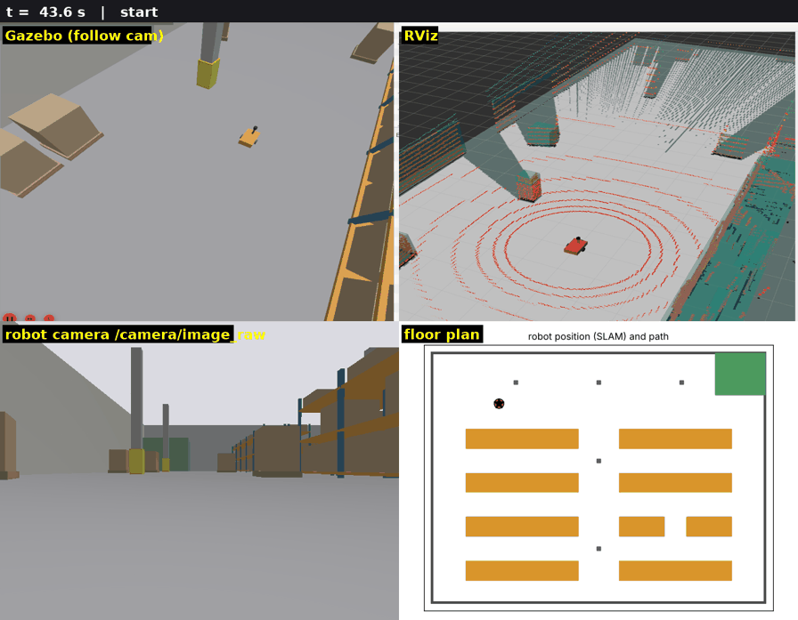
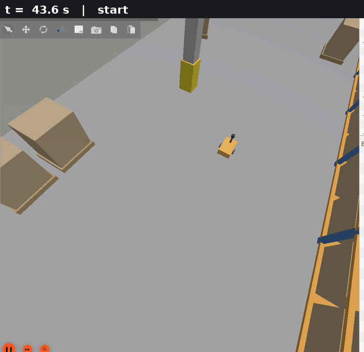
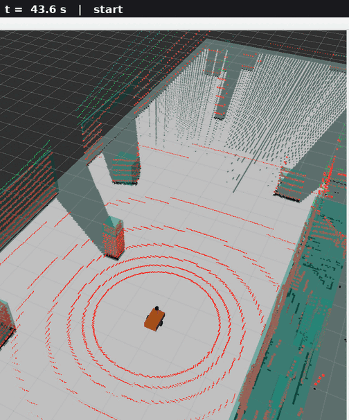
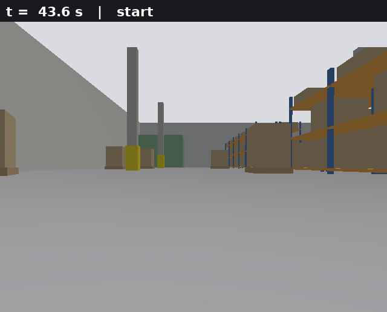
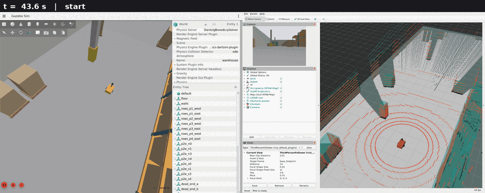
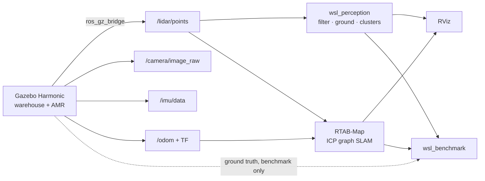

<div align="center">

# WSL — Warehouse Simulation Lab

**A warehouse mobile robot that maps, perceives, and measures its own accuracy.**

[](#supported-platforms)
[](#supported-platforms)
[](#ubuntu-2404)
[](#macos)
[](#perception-pipeline)
[](#benchmark)
[](LICENSE)


[Quick start](#quick-start) ·
[Demo](#demo) ·
[Performance](#performance) ·
[How it works](#how-it-works) ·
[Testing](#testing) ·
[Docs](#documentation)

</div>

<br/>

<div align="center">
  
  <br/>
  <sub>One run, four views: Gazebo follow cam · RViz SLAM · onboard camera · floor plan with the SLAM path</sub>
</div>

## Overview

WSL is a ROS 2 Jazzy and Gazebo Harmonic platform for developing and measuring
perception and mapping on a warehouse mobile robot. It answers engineering
questions with numbers: how far wheel odometry drifts, how much loop closure
recovers, what LiDAR resolution costs, and where the CPU goes.

| Component | Description |
|---|---|
| **Robot** | Differential-drive AMR with 3D LiDAR, RGB camera and IMU |
| **World** | 40 × 30 m warehouse with repetitive racks, pillars and dead ends |
| **Perception** | C++ / PCL point-cloud pipeline: filtering, ground removal, obstacle clusters |
| **SLAM** | RTAB-Map 3D LiDAR graph SLAM with ICP and loop closure |
| **Benchmarks** | Every estimate scored against ground truth: ATE, RPE, drift, latency, CPU |

## Demo

<table>
  <tr>
    <td width="50%" align="center">
      <br/>
      <b>Gazebo</b><br/><sub>The AMR driving between racks and pillars</sub>
    </td>
    <td width="50%" align="center">
      <br/>
      <b>RViz + RTAB-Map</b><br/><sub>LiDAR scans, 3D map cloud and occupancy grid</sub>
    </td>
  </tr>
  <tr>
    <td width="50%" align="center">
      <br/>
      <b>Onboard camera</b><br/><sub><code>/camera/image_raw</code> at 640 × 480, 20 Hz</sub>
    </td>
    <td width="50%" align="center">
      <br/>
      <b>Full desktop</b><br/><sub>Gazebo entity tree and RViz displays after launch</sub>
    </td>
  </tr>
</table>

## Quick start

### Ubuntu 24.04

Requires Ubuntu 24.04 LTS with ROS 2 Jazzy installed at `/opt/ros/jazzy`.

**1. Get the code**

```bash
git clone https://github.com/azerbenali/wsl.git
cd wsl
```

**2. Install dependencies**

```bash
source /opt/ros/jazzy/setup.bash
rosdep update && rosdep install --from-paths src --ignore-src -r -y
```

**3. Build**

```bash
colcon build --symlink-install
source install/setup.bash
```

**4. Launch**

```bash
ros2 launch wsl_sim warehouse.launch.py
```

**5. Drive** (second terminal)

```bash
sudo apt install ros-jazzy-teleop-twist-keyboard
ros2 run teleop_twist_keyboard teleop_twist_keyboard
```

### macOS

On macOS (Intel or Apple Silicon), WSL runs in a ready-made Ubuntu 24.04 / ROS 2
Jazzy environment as a VS Code dev container. Gazebo and RViz open in your browser.

| Step | Action |
|:---:|---|
| 1 | Install **Docker Desktop** and **VS Code** with the **Dev Containers** extension |
| 2 | In Docker Desktop → *Settings → Resources*, allocate at least **4 CPUs** and **8 GB** memory |
| 3 | Open the `wsl` folder in VS Code and choose **Reopen in Container** (first start installs ROS, Gazebo, RTAB-Map and builds the workspace, about 10–20 minutes) |
| 4 | In the VS Code terminal: `ros2 launch wsl_sim warehouse.launch.py` |
| 5 | Open <http://localhost:6080/vnc.html?autoconnect=1&resize=scale> to see Gazebo and RViz |

Build, test, run, benchmark and debug are available as VS Code tasks
(**Terminal → Run Task**) and debug configurations (**Run and Debug**).
The same dev container works on Windows.

## Performance

<details>
<summary><b>System metrics</b></summary>

<br/>

| System (`warehouse_loop`) | Measured |
|---|---|
| LiDAR / camera / IMU / odom rate (sim time) | 10.000 / 20.000 / 100.002 / 50.000 Hz, 0 stalls, 0 timestamp regressions |
| Perception processing inside the node | 16.4 ms mean, 43 ms max (period 100 ms), 0 rejected clouds |
| Perception end-to-end latency | 17.0 ms mean, 30.1 ms p95 |
| Perception point reduction (14 400 raw → ~6 175 filtered) | 57.1 % |
| Perception algorithm cost in isolation (`pipeline_benchmark`) | 5.6 ms mean, 7.3 ms p95 |
| Proximity loop closures | 5, first one when the loop closes (t = 192.4 s) |
| Real-time factor, full stack | 0.63 |
| CPU (% of one core): Gazebo / SLAM / perception / bridge / recorder | 169 / 35 / 13 / 9 / 39 |

Methodology: [docs/benchmarking.md](docs/benchmarking.md) ·
Profiling: [docs/architecture.md](docs/architecture.md#performance)

</details>

## How it works



### Robot and sensors

Differential-drive AMR · 0.60 × 0.38 m chassis · 0.08 m wheels on a 0.44 m track ·
31.3 kg · inertia computed from primitive shapes.

| Sensor | Interface | Frame | Configuration |
|---|---|---|---|
| 3D LiDAR (`gpu_lidar`) | `/lidar/points` `PointCloud2` | `lidar_link`, 0.50 m above ground | 16 channels ±15°, 900 samples/rev (0.4°), 10 Hz, 0.3–30 m, σ = 1 cm |
| RGB camera | `/camera/image_raw`, `/camera/camera_info` | `camera_optical_frame` | 640 × 480 `rgb8`, 20 Hz, 1.2 rad HFOV |
| IMU | `/imu/data` | `imu_link` | 100 Hz, MEMS-grade Gaussian noise and bias |
| Wheel odometry | `/odom`, TF `odom → base_footprint` | `base_footprint` | Gazebo DiffDrive, 50 Hz |

### Perception pipeline

`wsl_perception` (C++, PCL) turns `/lidar/points` into obstacles:

```
raw cloud → validate → transform + ROI → voxel grid → ground removal → clusters
```

1. **Validate and extract**: reject empty clouds, missing frame, non-float or missing
   xyz, big-endian and inconsistent step/size layouts before reading a byte; drop
   NaN/Inf; range-filter from the sensor origin, all in one pass.
2. **Transform + ROI** into `base_footprint` via TF.
3. **Voxel grid** (0.08 m).
4. **Ground removal**: RANSAC plane constrained to ≤ 0.15 rad tilt, fitted only to
   points below 0.3 m so shelf decks cannot win.
5. **Euclidean clustering** (0.25 m) → axis-aligned boxes.

**Outputs:** `/perception/filtered_points` · `/perception/obstacle_points` ·
`/perception/clusters` (`vision_msgs/Detection3DArray`) · `/perception/markers` ·
`/diagnostics` (input rate, processing time, rejections).

Every parameter has a unit in its name and a valid range, and the full set is
re-validated when changed at runtime.

### SLAM pipeline

RTAB-Map graph SLAM ([`wsl_slam/config/rtabmap.yaml`](src/wsl_slam/config/rtabmap.yaml)):

- Wheel odometry read from TF at each scan's stamp
- Point-to-plane ICP between consecutive graph nodes
- Loop closure by scan proximity
- 3-DoF optimization
- 2D occupancy grid projected from the 3D scans

Publishes `map → odom`, `/rtabmap/map`, `/rtabmap/mapPath` and `/rtabmap/cloud_map`.

## Launch options

```bash
ros2 launch wsl_sim warehouse.launch.py headless:=true rviz:=false
```

| Argument | Default | Meaning |
|---|---|---|
| `headless` | `false` | Gazebo server only; sensors still render offscreen |
| `rviz` | `true` | Start RViz (fixed frame `map` with SLAM, `odom` without) |
| `perception` | `true` | Start the point-cloud pipeline |
| `slam` | `true` | Start RTAB-Map |
| `ground_truth` | `false` | Publish `/ground_truth/odom` (evaluation only) |
| `world` | `warehouse` | World file in `wsl_sim/worlds` |
| `x`, `y`, `yaw` | `-12.0`, `9.0`, `0.0` | Spawn pose in the world frame |
| `lidar_channels`, `lidar_horizontal_samples`, `lidar_rate_hz` | `16`, `900`, `10` | LiDAR fidelity |
| `camera_rate_hz` | `20` | Camera frame rate |
| `odom_wheel_radius_scale`, `odom_wheel_separation_scale` | `1.0` | Odometry calibration error |

On machines without a GPU, Gazebo renders with Mesa; `headless:=true` uses `libegl-mesa0`.

## Benchmark

Run a scenario. The robot drives the route, then the launch exits:

```bash
ros2 launch wsl_benchmark benchmark.launch.py scenario:=warehouse_loop
```

Results are written to `results/warehouse_loop_<date>_<time>/` (raw CSVs and `metrics.json`).

| Scenario | Focus |
|---|---|
| `warehouse_loop` | Long loop, loop closure, odometry drift |
| `aisle_loop` | Repetitive rack geometry |
| `warehouse_loop_lowres` | Reduced LiDAR resolution |
| `manual` | Manual driving with full recording |

Recompute metrics from a recorded run:

```bash
ros2 run wsl_benchmark evaluate results/<run>
```

Benchmark the perception algorithms alone (no ROS graph, no simulator):

```bash
./build/wsl_perception/pipeline_benchmark 300
```

## Testing

```bash
colcon test && colcon test-result --verbose
```

| Suite | Tests |
|---|---|
| `wsl_perception` | GoogleTest: parser incl. hostile layouts, each stage, boundaries, config validation; randomized property tests; launch test of the real node |
| `wsl_benchmark` | pytest: metrics against analytic results, evaluation end to end, scenarios, pure pursuit |
| `wsl_description` | URDF structure, inertia physics, frame conventions, `check_urdf` |
| `wsl_sim` | Asset resolution, bridge directions, ground-truth isolation, bridge ↔ robot topic consistency |

End-to-end smoke test (launches the full system headless and checks sensors, frames,
rates, TF authorities and driving):

```bash
colcon build --cmake-args -DWSL_SIM_TESTS=ON && colcon test --packages-select wsl_sim
```

| Flag | Enables |
|---|---|
| `-DWSL_SANITIZE=ON` | ASan + UBSan |
| `-DWSL_BUILD_FUZZERS=ON` | libFuzzer target for the PointCloud2 parser (clang) |

CI runs build, tests, sanitizers, clang-format, flake8 and the simulation smoke test
on amd64 and arm64.

## Supported platforms

| | |
|---|---|
| OS | Ubuntu 24.04 LTS (native) · macOS and Windows (dev container) |
| ROS | ROS 2 Jazzy Jalisco |
| Simulator | Gazebo Harmonic (gz-sim 8) via `ros_gz` |
| SLAM | RTAB-Map (`rtabmap_slam`), PCL ICP backend |
| Languages | C++17 (perception), Python 3 (launch, benchmark) |
| Architectures | amd64 and arm64 |

## Documentation

| Document | Contents |
|---|---|
| [Architecture](docs/architecture.md) | Nodes, data flow, performance profiling |
| [Frames](docs/frames.md) | TF tree and frame conventions |
| [Benchmarking](docs/benchmarking.md) | Metrics and methodology |

---

<div align="center">

© 2026 Azer Ben Ali · [Apache-2.0](LICENSE) · v0.1.0

</div>
