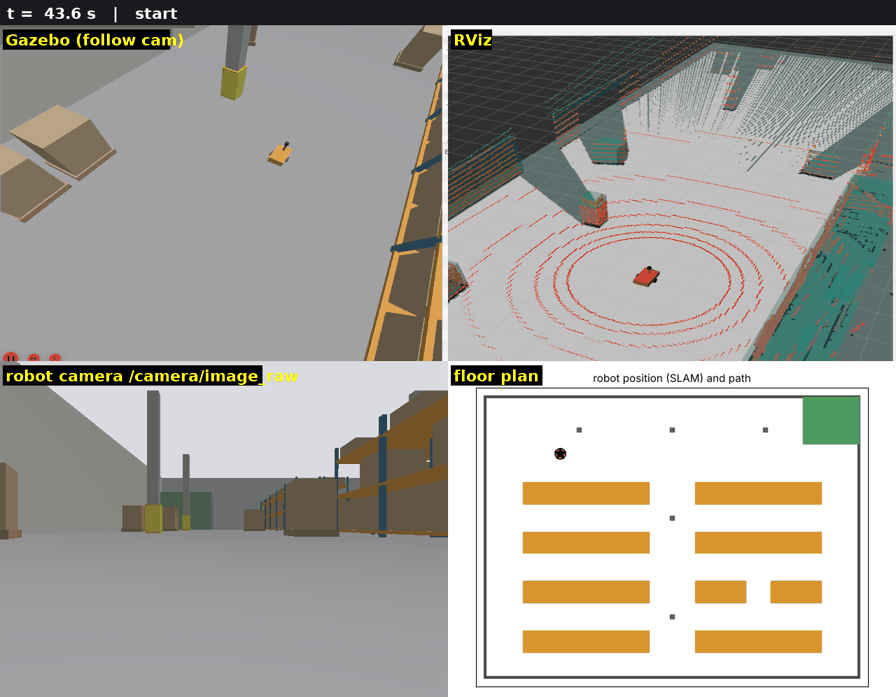
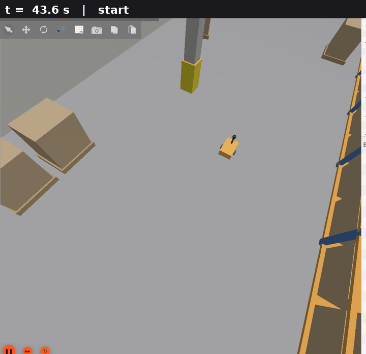
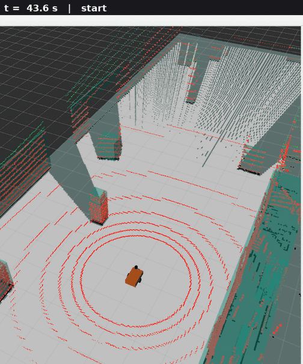
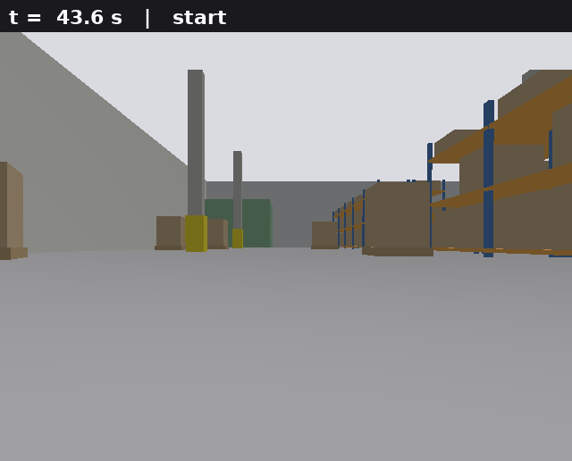
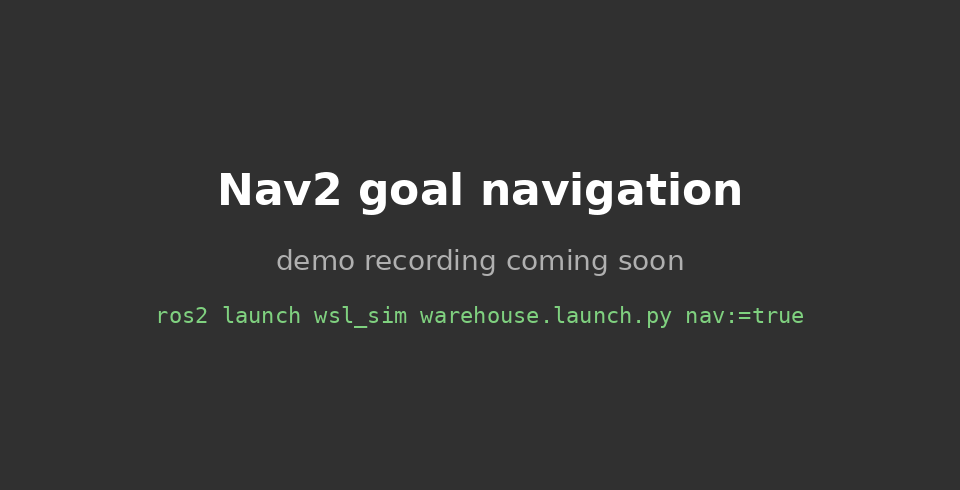
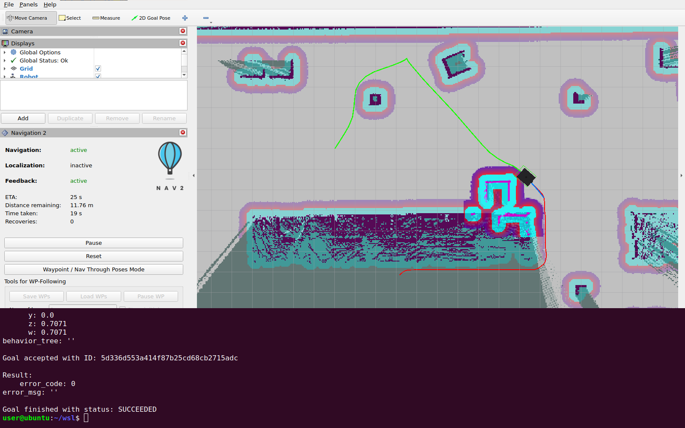

<div align="center">

# Warehouse Simulation Lab

**A warehouse mobile robot that maps, perceives, and measures its own accuracy.**

[](#supported-platforms)
[](#supported-platforms)
[](#navigation)
[](#ubuntu-2404)
[](#macos)
[](#supported-platforms)
[](#benchmark)
[](LICENSE)


[Quick start](#quick-start) ·
[Demo](#demo) ·
[Navigation](#navigation) ·
[Testing](#testing) ·
[Docs](#documentation)

</div>

<br/>

<div align="center">
  
  <br/>
  <sub>One run, four views: Gazebo follow cam · RViz SLAM · onboard camera · floor plan with the SLAM path</sub>
</div>

## Overview

| Component | Description |
|---|---|
| **Robot** | Robotnik RB-Summit-XL Steel with mecanum wheels, 3D LiDAR, RGB camera and IMU |
| **World** | 40 × 30 m warehouse with repetitive racks, pillars and dead ends |
| **Perception** | C++ / PCL point-cloud pipeline: filtering, ground removal, obstacle clusters |
| **SLAM** | RTAB-Map 3D LiDAR graph SLAM with ICP and loop closure |
| **Navigation** | Nav2 on the SLAM map: click a goal, Smac 2D plans, omnidirectional MPPI drives around racks and pillars |
| **Benchmarks** | Every estimate scored against ground truth: ATE, RPE, drift, latency, CPU |

## Demo

<table>
  <tr>
    <td width="50%" align="center">
      <br/>
      <b>Gazebo</b><br/><sub>The Summit Steel driving between racks</sub>
    </td>
    <td width="50%" align="center">
      <br/>
      <b>RViz + RTAB-Map</b><br/><sub>Robot model, LiDAR, SLAM map and obstacle clusters</sub>
    </td>
  </tr>
  <tr>
    <td width="50%" align="center">
      <br/>
      <b>Onboard camera</b><br/><sub><code>/camera/image_raw</code> at 640 × 480, 20 Hz</sub>
    </td>
    <td width="50%" align="center">
      <br/>
      <b>Robot model</b><br/><sub>TF axes, wheels turning from <code>/joint_states</code></sub>
    </td>
  </tr>
  <tr>
    <td width="50%" align="center">
      <br/>
      <b>Close-up</b><br/><sub>Robotnik meshes in Gazebo</sub>
    </td>
    <td width="50%" align="center">
      <br/>
      <b>In an aisle</b><br/><sub>Between rack rows in aisle A2</sub>
    </td>
  </tr>
  <tr>
    <td width="50%" align="center">
      <br/>
      <b>Warehouse</b><br/><sub>40 × 30 m, top down</sub>
    </td>
    <td width="50%" align="center">
      <br/>
      <b>Nav2</b><br/><sub>Goal from the terminal, then from RViz: global plan, MPPI local plan, costmaps</sub>
    </td>
  </tr>
</table>

## Quick start

### Ubuntu 24.04

Requires Ubuntu 24.04 LTS with ROS 2 Jazzy installed at `/opt/ros/jazzy`.

**1. Get the code**

```bash
git clone https://github.com/azerbenali/wsl.git
cd wsl
```

**2. Install dependencies**

```bash
source /opt/ros/jazzy/setup.bash
rosdep update && rosdep install --from-paths src --ignore-src -r -y
```

**3. Build**

```bash
colcon build --symlink-install
source install/setup.bash
```

**4. Launch**

```bash
ros2 launch wsl_sim warehouse.launch.py
```

**5. Drive** (second terminal)

```bash
sudo apt install ros-jazzy-teleop-twist-keyboard
ros2 run teleop_twist_keyboard teleop_twist_keyboard
```

### macOS

On macOS (Intel or Apple Silicon), WSL runs in a ready-made Ubuntu 24.04 / ROS 2
Jazzy environment as a VS Code dev container. Gazebo and RViz open in your browser.

| Step | Action |
|:---:|---|
| 1 | Install **Docker Desktop** and **VS Code** with the **Dev Containers** extension |
| 2 | In Docker Desktop → *Settings → Resources*, allocate at least **4 CPUs** and **8 GB** memory |
| 3 | Open the `wsl` folder in VS Code and choose **Reopen in Container** (first start installs ROS, Gazebo, RTAB-Map and builds the workspace, about 10–20 minutes) |
| 4 | In the VS Code terminal: `ros2 launch wsl_sim warehouse.launch.py` |
| 5 | Open <http://localhost:6080/vnc.html?autoconnect=1&resize=scale> to see Gazebo and RViz |

Build, test, run, benchmark and debug are available as VS Code tasks
(**Terminal → Run Task**) and debug configurations (**Run and Debug**).
The same dev container works on Windows.


## Navigation

```bash
ros2 launch wsl_sim warehouse.launch.py nav:=true
```

<div align="center">
  
  <br/>
  <sub>Goal set with 2D Goal Pose: global plan (red) around the rack block into aisle A3, MPPI local plan (blue), inflated costmaps, Navigation 2 panel</sub>
</div>

| Step | In RViz |
|:---:|---|
| 1 | Wait until the **Navigation 2** panel shows navigation *active* |
| 2 | Click **2D Goal Pose** in the toolbar |
| 3 | Click the target on the map and drag towards the heading the robot should have |

The robot plans around racks and pillars and drives there. From the command line
(`map` starts at the spawn pose, so world (−8.5, 13.4) is (3.5, 4.4)):

```bash
ros2 action send_goal /navigate_to_pose nav2_msgs/action/NavigateToPose \
  "{pose: {header: {frame_id: map}, pose: {position: {x: 3.5, y: 4.4}, orientation: {z: 0.7071, w: 0.7071}}}}"
```

Design, parameters and troubleshooting: [docs/navigation.md](docs/navigation.md).

## Launch options

```bash
ros2 launch wsl_sim warehouse.launch.py headless:=true rviz:=false
```

| Option | Default | Effect |
|---|---|---|
| `headless` | `false` | Gazebo server only; sensors still render offscreen |
| `rviz` | `true` | Start RViz |
| `perception` | `true` | Start the point-cloud perception node |
| `slam` | `true` | Start RTAB-Map |
| `nav` | `false` | Start Nav2 (requires `slam:=true`) |
| `ground_truth` | `false` | Publish evaluation-only ground truth |


## Benchmark

Run a scenario. The robot drives the route, then the launch exits:

```bash
ros2 launch wsl_benchmark benchmark.launch.py scenario:=warehouse_loop
```

Results are written to `results/warehouse_loop_<date>_<time>/` (raw CSVs and `metrics.json`).

| Scenario | Focus |
|---|---|
| `warehouse_loop` | Long loop, loop closure, odometry drift |
| `aisle_loop` | Repetitive rack geometry |
| `warehouse_loop_lowres` | Reduced LiDAR resolution |
| `manual` | Manual driving with full recording |

Recompute metrics from a recorded run:

```bash
ros2 run wsl_benchmark evaluate results/<run>
```

Benchmark the perception algorithms alone (no ROS graph, no simulator):

```bash
./build/wsl_perception/pipeline_benchmark 300
```

## Testing

```bash
colcon test && colcon test-result --verbose
```

| Suite | Tests |
|---|---|
| `wsl_perception` | GoogleTest: parser incl. hostile layouts, each stage, boundaries, config validation; randomized property tests; launch test of the real node |
| `wsl_benchmark` | pytest: metrics against analytic results, evaluation end to end, scenarios, pure pursuit |
| `wsl_description` | URDF structure, inertia physics, mesh checks (collisions match, roller direction, no z-fighting), LiDAR clearance, drive limits, frame conventions, `check_urdf` |
| `wsl_sim` | Asset and robot mesh resolution, bridge directions, ground-truth isolation, bridge ↔ robot topic consistency |
| `wsl_navigation` | Nav2 config against the robot model and the system: frames, no AMCL / map_server, footprint = chassis, limits inside MecanumDrive, MPPI Omni, real topics, `/cmd_vel` chain ends in `Twist` |

End-to-end smoke test (launches the full system headless and checks sensors, frames,
rates, TF authorities and driving):

```bash
colcon build --cmake-args -DWSL_SIM_TESTS=ON && colcon test --packages-select wsl_sim
```

End-to-end navigation test (full system with Nav2; drives to a goal around a pillar
and checks the outcome and the final pose). Run it on its own, with the overlay sourced:

```bash
source install/setup.bash && colcon test --packages-select wsl_navigation
```

| Flag | Enables |
|---|---|
| `-DWSL_SANITIZE=ON` | ASan + UBSan |
| `-DWSL_BUILD_FUZZERS=ON` | libFuzzer target for the PointCloud2 parser (clang) |

CI runs build, tests, sanitizers, clang-format, flake8 and the simulation smoke and
navigation tests on amd64 and arm64.

## Supported platforms

| | |
|---|---|
| OS | Ubuntu 24.04 LTS (native) · macOS and Windows (dev container) |
| ROS | ROS 2 Jazzy Jalisco |
| Simulator | Gazebo Harmonic (gz-sim 8) via `ros_gz` |
| SLAM | RTAB-Map (`rtabmap_slam`), PCL ICP backend |
| Navigation | Nav2 (Jazzy): Smac 2D planner, MPPI controller |
| Languages | C++17 (perception), Python 3 (launch, benchmark) |
| Architectures | amd64 and arm64 |

## Third party assets

| | |
|---|---|
| Copyright | © 2025 Robotnik Automation S.L. |
| Licence | BSD-3-Clause, kept with the files: [`meshes/rbsummit_steel/LICENSE`](src/wsl_description/meshes/rbsummit_steel/LICENSE) |

## Documentation

| Document | Contents |
|---|---|
| [Architecture](docs/architecture.md) | Nodes, data flow, performance profiling |
| [Benchmarking](docs/benchmarking.md) | Metrics and methodology |
| [Navigation](docs/navigation.md) | Nav2 architecture, design decisions, parameters, troubleshooting |

---

<div align="center">

© 2026 Azer Ben Ali · [Apache-2.0](LICENSE) · v0.2.0

</div>
