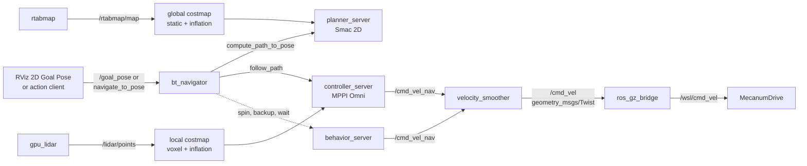

# Navigation

With `nav:=true`, Nav2 drives the robot to a goal on the map RTAB-Map builds
while it drives: click **2D Goal Pose** in RViz, and the robot plans a path
around racks and pillars and follows it with an omnidirectional MPPI
controller.

```bash
ros2 launch wsl_sim warehouse.launch.py nav:=true
```

Configuration and launch live in `wsl_navigation`
([`config/nav2.yaml`](../src/wsl_navigation/config/nav2.yaml),
[`launch/navigation.launch.py`](../src/wsl_navigation/launch/navigation.launch.py)).
It contains no code: Nav2 is mature, and the work is choosing its inputs and
parameters for this robot.

## Architecture



Localisation is not part of Nav2 here. RTAB-Map publishes `map → odom`,
MecanumDrive publishes `odom → base_footprint`, and Nav2 only reads TF
([frames](frames.md)). The lifecycle manager `lifecycle_manager_navigation`
configures and activates the seven servers in order. Recovery behaviours (dotted)
run only when planning or control fails.

## Design decisions

| Decision | Reason |
|---|---|
| No AMCL, no map_server | RTAB-Map already owns `map → odom` and builds the map; a second localiser would fight it for the same transform. |
| MPPI with `motion_model: Omni` | The mecanum base is holonomic; MPPI samples vx, vy and wz, so it can strafe to centre itself in an aisle or slip past a pillar. |
| Heading kept on the path (PathAngleCritic, 0.35 rad) | With the default 1.0 rad band, MPPI crabbed sideways for > 90 % of a drive, because using both axes is faster; the forward camera should look where the robot goes. |
| Smac 2D, `allow_unknown: true` | A holonomic robot needs no kinematic search; the map grows while driving, so paths and goals in still unknown space must be allowed. |
| Voxel layer fed by the raw 3D cloud | `/lidar/points` is used directly, with no 2D scan conversion; 3D clearing keeps low obstacles marked inside the LiDAR's blind zone close to the robot. |
| Rectangular footprint | The robot is 0.72 × 0.58 m; a circle would be 0.92 m wide and not fit the 0.9 m passage in aisle A3. |
| `Twist`, not `TwistStamped` | The bridge and MecanumDrive take `geometry_msgs/Twist`; every Nav2 node that publishes a velocity has `enable_stamped_cmd_vel: false`. |
| Velocity smoother last | Every command, from MPPI and from recovery behaviours, passes one place that enforces the limits. |

## Key parameters

| Parameter | Value | Reason |
|---|---|---|
| `footprint` | chassis box 0.719 × 0.57862 m, centred | Read from the URDF chassis; a test compares them. |
| `footprint_padding` | 0.05 m | Covers the wheel collision spheres (4.2 cm out at the sides) and the camera (3.1 cm out at the front). |
| `inflation_radius` / `cost_scaling_factor` | 0.70 m / 3.0 | ≥ the 0.53 m circumscribed radius, which MPPI's footprint check needs; costs fall off gently, so the robot keeps to the middle of 3 m aisles. |
| voxel `min_obstacle_height` | 0.10 m | Floor returns of the lowest ring lie within millimetres of z = 0; every warehouse obstacle reaches higher. |
| voxel `max_obstacle_height` | 1.0 m | The robot is 0.70 m tall; overhangs above 1.0 m cannot touch it. The voxel grid spans exactly 0–1.0 m (10 × 0.1 m). |
| local costmap | 6 × 6 m rolling, 0.05 m | Covers the 1.7 m MPPI horizon in every direction. |
| global costmap `resolution` | 0.05 m | Same cell size as RTAB-Map's grid, so the map is copied cell by cell. |
| static layer `map_subscribe_transient_local` | true | RTAB-Map publishes `/rtabmap/map` reliable and transient local. |
| MPPI `vx` / `vy` / `wz` | 0.6, −0.3 / ±0.4 / ±1.0 | Conservative indoor speeds, inside the MecanumDrive limit of 1.5. |
| MPPI and smoother accelerations | 0.5 m/s², 0.5 m/s², 0.8 rad/s² | Inside the MecanumDrive limit of 1.0, so the smoother, not the plant, is the limiting element. MPPI and the smoother use identical limits. |
| MPPI `time_steps` × `model_dt` | 56 × 0.05 s | 2.8 s horizon; `model_dt` = 1 / `controller_frequency` (20 Hz). |
| `CostCritic.consider_footprint` | true | Collision checks with the rectangle, not a circle. |
| `PathAngleCritic` | 0.35 rad band, weight 4.0 | Keeps the heading on the path ahead; with the default 1.0 rad band (and TwirlingCritic at 10) the robot crabbed for > 90 % of a drive. |
| `TwirlingCritic.cost_weight` | 5.0 | Stops spinning while translating; half the usual 10, so turning to face the path is not made expensive. |
| MPPI `transform_tolerance` | 0.5 s | How long MPPI waits for `map → odom`. RTAB-Map can pause its 20 Hz publication for > 0.2 s while it integrates a node; at 0.1 s goals aborted at start. |
| goal checker | 0.25 m, 0.25 rad, stateful | Nav2 defaults; stateful, so once in position the robot only finishes rotating. |
| Smac `cost_travel_multiplier` | 2.0 | Keeps paths in the middle of aisles, away from rack faces. |
| behaviours `rotational_acc_lim` | 0.8 rad/s² | The Nav2 default (3.2) exceeds the MecanumDrive limit. |

`wsl_navigation/test/test_nav2_config.py` checks the frames against this
documentation, the footprint and all limits against the expanded robot model,
the topics against the bridge, and the velocity chain.

## Measured behaviour

Headless, in an 8-CPU arm64 Docker container (Mesa llvmpipe), with SLAM and
perception running, final configuration. Wall-clock times.

| Goal (`map`) | Route | Runs | Result | Time | Peak \|vy\| |
|---|---|---|---|---|---|
| spawn → (3.5, 4.4), 90° | 5.6 m away across the staging area, around `pillar_n_west` (the navigation test) | 4 | all succeeded within tolerance | 20 s | – |
| (3.0, −6.9) → (3.5, 4.4), 90° | 16 m back from aisle A3 to the staging area | 2 | succeeded, ≤ 0.16 m, ≤ 0.24 rad off | 49–51 s | 0.23 m/s |
| (3.5, 4.4) → (3.0, −6.9), 0° | 16 m: cross aisle, around the P4 rack block, into aisle A3 | 3 | succeeded, ≤ 0.05 m, ≤ 0.19 rad off | 58–61 s | 0.40 m/s |

On open legs the robot faces its path and uses vy for corrections; turning into
an aisle it strafes at the full 0.4 m/s. No recovery behaviour was triggered.
The final heading is typically 0.15–0.24 rad off: the stateful goal checker stops
as soon as the yaw is inside its 0.25 rad tolerance.

## How to run

```bash
ros2 launch wsl_sim warehouse.launch.py nav:=true
```

`nav:=true` requires `slam:=true` (the default); with `slam:=false` the launch
stops before starting anything and says why. Nav2 can also run on its own next
to a running system:

```bash
ros2 launch wsl_navigation navigation.launch.py [params_file:=my_nav2.yaml] [autostart:=false]
```

### Send a goal from RViz

1. Wait until the **Navigation 2** panel shows *active* for navigation (a few
   seconds after RTAB-Map publishes its first map).
2. Click **2D Goal Pose** in the toolbar.
3. Click the target on the map and drag in the direction the robot should
   face. The global plan (red) and MPPI's local plan (blue) appear, and the
   robot drives.

The tool publishes `/goal_pose`, which `bt_navigator` turns into a
`NavigateToPose` goal. A new goal replaces the current one.

### Send a goal from the command line

The `map` frame starts at the spawn pose, (−12, 9) facing +x in the world by
default, so a world point (x, y) is (x + 12, y − 9) in `map`.

```bash
ros2 action send_goal /navigate_to_pose nav2_msgs/action/NavigateToPose \
  "{pose: {header: {frame_id: map}, pose: {position: {x: 3.5, y: 4.4}, orientation: {z: 0.7071, w: 0.7071}}}}" \
  --feedback
```

The orientation is a quaternion about z: `z = sin(yaw / 2)`, `w = cos(yaw / 2)`
(here yaw = 90°, facing north).

## Troubleshooting

| Symptom | Check |
|---|---|
| Robot does not move | Trace the velocity chain. `ros2 topic info -v /cmd_vel` must list exactly one publisher, `velocity_smoother`, with type `geometry_msgs/msg/Twist`, and `gz_bridge` as subscriber. If `/cmd_vel_nav` has data (`ros2 topic hz /cmd_vel_nav`) but `/cmd_vel` does not, the smoother is not active (`ros2 lifecycle get /velocity_smoother`). A `TwistStamped` type means `enable_stamped_cmd_vel` is true somewhere, and the bridge drops it. Teleop publishing on `/cmd_vel` at the same time fights Nav2. |
| Goal rejected or aborted at once | TF first: `ros2 run tf2_ros tf2_echo map base_footprint` must resolve (no `map` frame means SLAM is not running). Goals must be in the `map` frame. Then the costmap: a goal inside a rack or its inflation cannot be reached; check the global costmap in RViz. `Unable to transform goal pose into costmap frame` means `map → odom` arrived later than MPPI's `transform_tolerance`. |
| Oscillation, or slow sideways crabbing | MPPI critics. PathAngleCritic (weight, `max_angle_to_furthest`) turns the robot towards its path, TwirlingCritic resists turning; if one dominates, the robot either strafes everywhere or swings back and forth. `Control loop missed its desired rate` means the CPU is short: lower `batch_size`. |
| Robot keeps too far from racks, or will not enter the 0.9 m passage | Inflation: lower `inflation_radius` (not below the 0.53 m circumscribed radius) or raise `cost_scaling_factor`; Smac's `cost_travel_multiplier` also pushes paths away from obstacles. The passage needs the padded half-width (0.34 m) to stay below 0.45 m. |

Two messages at startup are expected: `Robot is out of bounds of the costmap`
(once, before the first map arrives) and Smac's `Inflation layer either not
found or inflation is not set sufficiently...`, which this Nav2 release logs at
configure time for any footprint, including a circular one.
